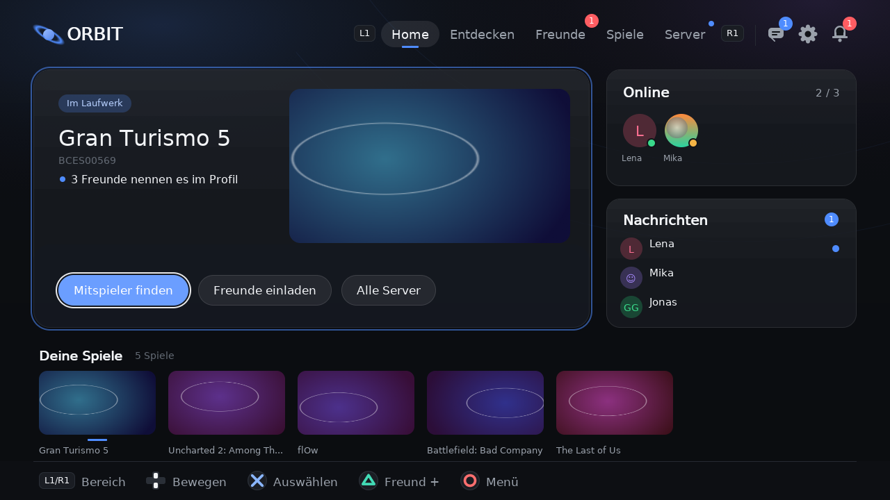

 

**Text. Sprache. Freunde. Communitys. Ein verbundenes PS3-Erlebnis.**

[English](README.md) · **Deutsch** · [Français](README-FR.md) · [Español](README-ES.md)

[**⬇ ORBIT 1.2.0 herunterladen**](https://github.com/C2V4ZA/ORBIT/releases/tag/v1.2.0) &nbsp;·&nbsp; [Anleitung](docs/Anleitung-DE.md) &nbsp;·&nbsp; [Installation](docs/INSTALLATION.md) &nbsp;·&nbsp; [Funktionen](docs/FEATURES.md) &nbsp;·&nbsp; [FAQ](docs/FAQ.md) &nbsp;·&nbsp; [Änderungen](CHANGELOG.md)

---

> [!IMPORTANT]
> **Neues offizielles Konto.** ORBIT wurde von seinem Entwickler zuerst unter dem GitHub-Konto **C2V3ZA** veröffentlicht. Der Zugang ging wegen eines Problems mit der hinterlegten E-Mail-Adresse verloren, und das Konto wurde gelöscht. **C2V4ZA ist das neue offizielle Konto desselben Entwicklers** – kein Fork, keine Kopie, und ORBIT wird weiterentwickelt. [Zur vollständigen Ankündigung](docs/ACCOUNT-MIGRATION.md#deutsch).

## Was ist ORBIT?

ORBIT ist eine unabhängige Homebrew-App, die moderne Kommunikation auf die PlayStation 3 bringt: Textchat, Sprachchat, Freunde, private Nachrichten und Community-Server mit Kanälen und Rollen – direkt von PS3 zu PS3.

- **Kein Konto, kein Passwort.** Jede PS3 meldet sich mit einem eigenen geheimen Schlüssel an.
- **Keine Router-Einstellungen, kein PC.** Im selben Netz finden sich die Konsolen selbst; übers Internet öffnet ORBIT einen eigenen Tunnel.
- **Deine Daten bleiben auf PS3s.** Jeder Server liegt auf der PS3, die ihn erstellt hat. Es gibt keinen ORBIT-Firmenserver.
- **Spricht deine Sprache.** 9 Sprachen, automatisch nach der PS3-Systemsprache.

 Startseite von ORBIT 1.2.0 – gerendert vom echten Oberflächen-Code der App mit Beispieldaten.

## Neu in 1.2.0

| | |
|---|---|
| **Neue Oberfläche** | Glas-Design, gemeinsame obere Leiste (L1/R1), Spotlight-Startseite, 8 Designs, neues Intro, Klänge, Emoji-Tastatur, Nicht stören |
| **Entdecken** | Öffentliche Communitys auf verbundenen PS3s – Suche, Filter, Sortierung, Details, Online/Offline-Anzeige, gespeicherte Liste, wenn ein Gastgeber offline ist |
| **Spiele** | Deine installierten PS3-Spiele und welche Freunde sie angeben oder gerade spielen |
| **Hintergrund-Benachrichtigungen** | Neue Nachrichten erscheinen oben rechts im XMB und in Spielen – auch wenn ORBIT geschlossen ist (Plugin) |
| **Profilbilder** | Vom USB-Stick oder vom **Handy** (QR-Code scannen) |
| **Animierte Bilder** | GIF-Profilbilder und Server-Icons (max. 10 Bilder/s, 15 s, 150 Bilder), Pause bei hoher Last, Einstellung *Bewegung reduzieren* |
| **Server-Aussehen** | Eigenes Bild oder animiertes Icon, Symbol, Farbe, Banner, Zurücksetzen, Vorschau mit Zuschnitt, **Änderungsprotokoll** – nur Besitzer und Rollen mit *Server verwalten*, geprüft vom Gastgeber |
| **Moderation** | Meldungen, Meldeliste für Moderatoren, zeitlich begrenzte Sperren (1 / 7 / 30 Tage / bis aufgehoben), Namensfilter |
| **Sprachen** | Deutsch, English, Français, Español, Italiano, Português, **Русский, Українська, Norsk bokmål** – Pluralformen, kyrillische und nordische Tastatur, lokale Wortvorschläge |
| **Signierte Updates** | ORBIT prüft auf Ed25519-signierte Updates; nichts wird von selbst installiert |

Alles aus 1.0.3 ist weiterhin da: Freunde, private und Gruppenchats, Offline-Nachrichten, Community-Server mit Kategorien, Rollen und Rechten, Sprachkanäle, Profile. Alle Änderungen: [CHANGELOG.md](CHANGELOG.md)

> [!NOTE]
> **1.2.0 ist neu.** Die Hintergrund-Benachrichtigungen wurden auf einer echten PS3 bestätigt. Die meisten anderen 1.2-Funktionen wurden am PC getestet (automatische Tests, Sanitizer, Fuzzing) und werden gerade noch auf echter PS3-Hardware getestet. Probleme bitte unter [Issues](https://github.com/C2V4ZA/ORBIT/issues) melden.

## Screenshots

<table>
<tr>
<td width="50%"> <b>Entdecken</b> – PS3-Communitys finden, auch wenn ein Gastgeber offline ist</td>
<td width="50%"> <b>Spiele</b> – deine PS3-Spiele und was Freunde spielen</td>
</tr>
<tr>
<td> <b>Community-Server</b> – Kanäle, Rollen, Sprache</td>
<td> <b>Profilbild vom Handy</b> – scannen, auswählen, fertig</td>
</tr>
</table>

Alle Screenshots stammen vom Oberflächen-Renderer von ORBIT 1.2.0 (derselbe C-Code wie auf der PS3) mit Beispielnamen und -nachrichten.

## Sprachen

Vollständig: **Deutsch, English, Français, Español, Italiano, Português, Русский, Українська, Norsk bokmål**.

Die Sprachseite zeigt auch, welche Sprachen **noch nicht verfügbar** sind, und warum: Japanisch, Koreanisch, Chinesisch und Hindi brauchen eine Schrift, die ORBIT noch nicht mitbringt; Arabisch braucht Rechts-nach-links-Text und Buchstabenverbindungen; die übrigen europäischen Sprachen sind noch nicht übersetzt. ORBIT zeigt eine Sprache nie als vollständig an, wenn sie es nicht ist.

## Bald: 24/7-Server

Heute ist ein Server nur online, solange ORBIT auf der Gastgeber-PS3 läuft. Wir arbeiten an einem **immer erreichbaren ORBIT-Server**: Communitys **bleiben online, auch wenn die PS3 des Gastgebers ausgeschaltet ist** – Nachrichten, Mitglieder und Kanäle rund um die Uhr erreichbar. Er wird freiwillig sein; ORBIT funktioniert weiterhin direkt von PS3 zu PS3.

## Herunterladen & installieren

1. **[Orbit-PS3-1.2.0.pkg](https://github.com/C2V4ZA/ORBIT/releases/tag/v1.2.0)** herunterladen (Titel-ID `ORB000001`).
2. Auf einen FAT32-USB-Stick kopieren und mit dem **Package Manager** auf einer PS3 mit **CFW oder HEN** installieren.
3. **Orbit Chat** in der Spalte „Spiel“ starten.

Deine Daten aus 1.0.x bleiben erhalten. Ausführlich: **[Anleitung (Deutsch)](docs/Anleitung-DE.md)** · [Installation (Englisch)](docs/INSTALLATION.md)

> [!WARNING]
> Beim Update bleiben Freunde, Server, Nachrichten und Name erhalten. **Zurück auf eine ältere Version ist nicht möglich.**

## Gut zu wissen

- Ein Server ist nur erreichbar, solange ORBIT auf der Gastgeber-PS3 läuft (24/7-Server sind geplant, siehe oben).
- Die Verbindungen zwischen den Konsolen sind verschlüsselt, aber **die Gastgeber-PS3 kann die Nachrichten ihrer eigenen Server und privaten Chats lesen** – ORBIT verspricht keine Ende-zu-Ende-Verschlüsselung. Siehe [docs/PRIVACY.md](docs/PRIVACY.md).
- Bilder werden von ORBITs eigenen, strengen PNG-, JPEG- und GIF-Lesern geprüft; nur eine neu kodierte 96 × 96-Version verlässt deine PS3, nie die Originaldatei.
- Kein Sprachchat während eines Spiels (die PS3 führt nur ein Programm gleichzeitig aus). Hintergrund-Benachrichtigungen funktionieren aber in Spielen.
- Der PS5-Controller kann als Mikrofon genutzt werden; über seinen Lautsprecher kann der Sprachchat nicht wiedergegeben werden. Mehr: [docs/AUDIO.md](docs/AUDIO.md)
- Alle Grenzen und bekannten Probleme: [docs/FAQ.md](docs/FAQ.md) · [docs/TROUBLESHOOTING.md](docs/TROUBLESHOOTING.md)

## Mit KI-Unterstützung entwickelt

ORBIT wurde mit **umfangreicher Hilfe künstlicher Intelligenz** entwickelt: Architektur, C-Programmierung, Funktionen, Oberfläche, Netzwerk, Audio, Fehlersuche, Tests, Übersetzungen, Dokumentation und Release-Vorbereitung. Die Idee, die kreative Richtung und die wichtigen Entscheidungen kommen vom menschlichen Entwickler, der die Versionen auf echter PlayStation-3-Hardware testet. Wir sagen das offen, weil du wissen sollst, wie die Software entstanden ist, die du installierst.

## Lizenz & Rechtliches

ORBIT ist freie Software unter der [GPL-3.0-or-later](LICENSE). Fremdkomponenten und ihre Lizenzen: [THIRD-PARTY.md](THIRD-PARTY.md).

ORBIT ist ein unabhängiges Homebrew-Projekt und **steht in keiner Verbindung zu Sony Interactive Entertainment**. „PlayStation“ und „PS3“ sind Marken der jeweiligen Inhaber und werden nur zur Beschreibung der Kompatibilität genannt.

  ORBIT — PlayStation-3-Spieler wieder verbinden.

