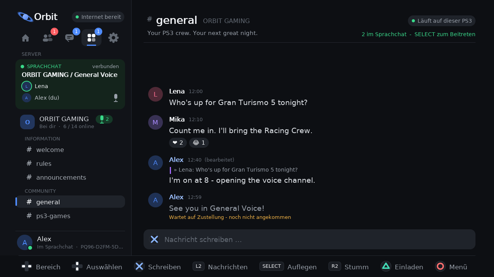
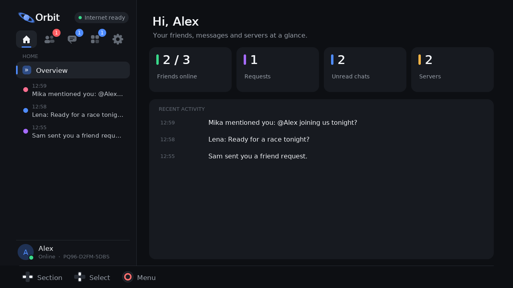
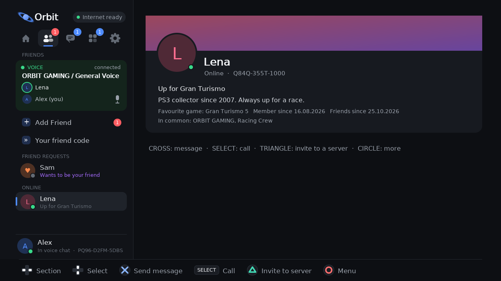
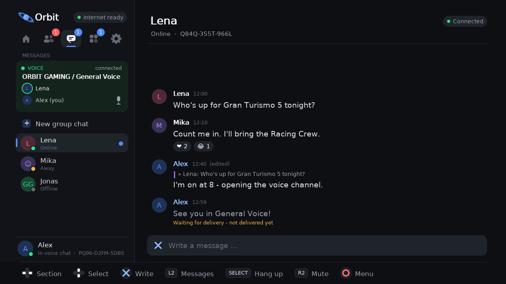
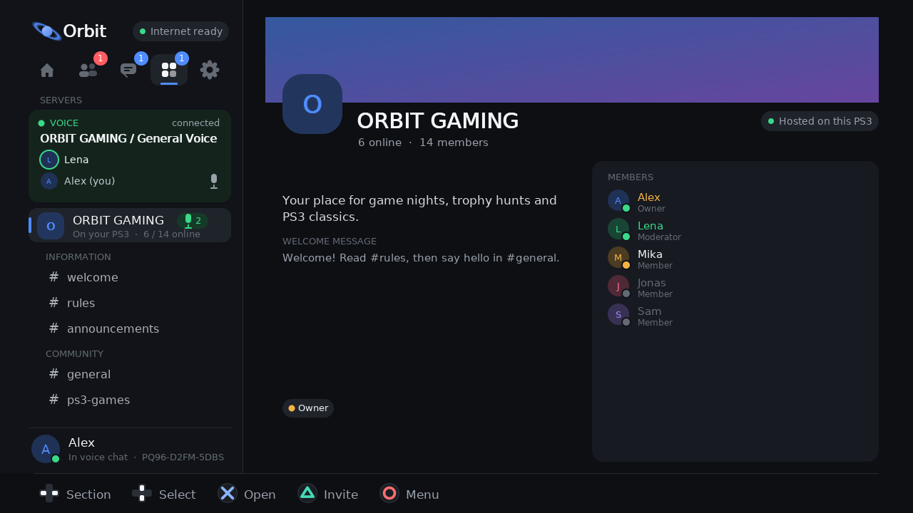
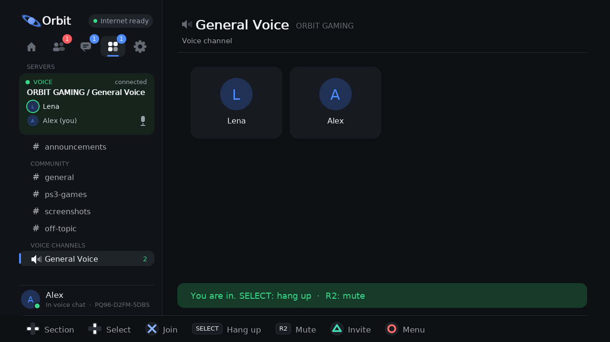
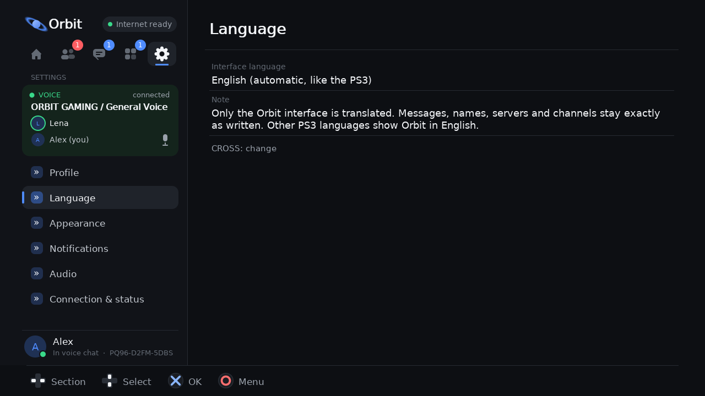

 

**Text. Sprache. Freunde. Communitys. Ein verbundenes PS3-Erlebnis.**

[English](README.md) · **Deutsch** · [Français](README-FR.md) · [Español](README-ES.md)

[**⬇ ORBIT 1.0.3 herunterladen**](https://github.com/C2V4ZA/ORBIT/releases/tag/v1.0.3) &nbsp;·&nbsp; [Anleitung](docs/Anleitung-DE.md) &nbsp;·&nbsp; [Installation](docs/INSTALLATION.md) &nbsp;·&nbsp; [Funktionen](docs/FEATURES.md) &nbsp;·&nbsp; [FAQ](docs/FAQ.md)

---

> [!IMPORTANT]
> **Neues offizielles Konto.** ORBIT wurde von seinem Entwickler zuerst unter dem GitHub-Konto **C2V3ZA** veröffentlicht. Der Zugang ging wegen eines Problems mit der hinterlegten E-Mail-Adresse verloren, und das Konto wurde gelöscht. **C2V4ZA ist das neue offizielle Konto desselben Entwicklers** – kein Fork, keine Kopie, und ORBIT wird weiterentwickelt. [Zur vollständigen Ankündigung](docs/ACCOUNT-MIGRATION.md#deutsch).

## Was ist ORBIT?

ORBIT ist eine unabhängige Homebrew-App, die moderne Kommunikation auf die PlayStation 3 bringt: Textchat, Sprachchat, Freunde, private Nachrichten und Community-Server mit Kanälen und Rollen – direkt von PS3 zu PS3.

- **Kein Konto, kein Passwort.** Jede PS3 meldet sich mit einem eigenen geheimen Schlüssel an.
- **Keine Router-Einstellungen, kein PC.** Im selben Netz finden sich die Konsolen selbst; übers Internet öffnet ORBIT einen eigenen Tunnel.
- **Deine Daten bleiben auf PS3s.** Jeder Server liegt auf der PS3, die ihn erstellt hat. Es gibt keinen ORBIT-Firmenserver.
- **Spricht deine Sprache.** Die Oberfläche folgt der PS3-Systemsprache: Deutsch, Englisch, Französisch oder Spanisch.

 Community-Server in ORBIT 1.0.3 – gerendert vom echten Oberflächen-Code der App mit Beispieldaten.

## Das bringt 1.0.3

| | |
|---|---|
| **Freunde** | 20-stelliger Freundescode, Anfragen, annehmen/ablehnen, entfernen, blockieren, feste Orbit-ID pro PS3 |
| **Nachrichten** | Einzel- und Gruppenchats, Antworten, Bearbeiten, Löschen, 6 Reaktionen, Suche, Stummschalten, Zeitstempel |
| **Offline-Nachrichten** | Nachrichten warten auf deiner PS3 („Wartet auf Zustellung“) und werden zugestellt, sobald die andere PS3 erreichbar ist |
| **Community-Server** | Kategorien, Text- und Sprachkanäle, Vorlagen, Beschreibung, Willkommensnachricht, Icon, Farbe, Banner, öffentlich oder privat |
| **Rollen & Rechte** | Owner, Admin, Moderator, Member + eigene Rollen, 10 Berechtigungen – geprüft von der Gastgeber-PS3 |
| **Sprachkanäle** | Kanal wechseln, Personen für dich stummschalten, Lautstärke pro Person 0–200 %, Server-Stummschaltung durch Moderatoren |
| **Profile** | Profilbild, Profilfarbe, Über mich, Lieblingsspiel, eigener Status, Online / Abwesend / Beschäftigt / Unsichtbar |
| **Benachrichtigungen** | Anfragen, DMs, Erwähnungen, Anrufe, Einladungen, Moderation – jeder Typ einzeln abschaltbar |
| **Designs** | Dark, Blue, Purple, Minimal |
| **Sprachen** | Deutsch, Englisch, Französisch, Spanisch – automatisch nach PS3-Systemsprache |

Alle Funktionen: [docs/FEATURES.md](docs/FEATURES.md) (Englisch)

## Screenshots

<table>
<tr>
<td width="50%"> <b>Home</b> – Freunde, Chats und Server auf einen Blick</td>
<td width="50%"> <b>Freunde</b> – Profil, Status, Orbit-ID, gemeinsame Server</td>
</tr>
<tr>
<td> <b>Nachrichten</b> – private Einzel- und Gruppenchats</td>
<td> <b>Community-Server</b> – Übersicht, Mitglieder, Rollen</td>
</tr>
<tr>
<td> <b>Sprachchat</b> – Sprachkanäle mit Teilnehmern</td>
<td> <b>Einstellungen</b> – Sprache, Design, Benachrichtigungen, Audio, Datenschutz</td>
</tr>
</table>

Alle Screenshots stammen vom Oberflächen-Renderer von ORBIT 1.0.3 (derselbe C-Code wie auf der PS3) mit Beispielnamen und -nachrichten.

## Herunterladen & installieren

1. **[Orbit-PS3-1.0.3.pkg](https://github.com/C2V4ZA/ORBIT/releases/tag/v1.0.3)** herunterladen (Titel-ID `ORB000001`).
2. Auf einen FAT32-USB-Stick kopieren und mit dem **Package Manager** auf einer PS3 mit **CFW oder HEN** installieren.
3. **Orbit Chat** in der Spalte „Spiel“ starten und den Namen bestätigen.

Ausführlich: **[Anleitung (Deutsch)](docs/Anleitung-DE.md)** · [Installation (Englisch)](docs/INSTALLATION.md)

> [!WARNING]
> Beim Update von 0.9.5 bleiben Gruppen, Nachrichten und Name erhalten – Gruppen werden automatisch zu Servern. **Zurück von 1.0.3 auf 0.9.5 ist nicht möglich.**

## PS5-Controller

Der PS5-Controller kann in ORBIT als Mikrofon zum Sprechen verwendet werden. Die Stimmen anderer Teilnehmer können jedoch nicht über den Lautsprecher des Controllers wiedergegeben werden. Verwende dafür den Fernseher oder ein unterstütztes Audiogerät. Mehr: [docs/AUDIO.md](docs/AUDIO.md)

## Gut zu wissen

- Ein Server ist nur erreichbar, solange ORBIT auf der Gastgeber-PS3 läuft.
- Die Verbindungen zwischen den Konsolen sind verschlüsselt, aber **die Gastgeber-PS3 kann die Nachrichten ihrer eigenen Server und privaten Chats lesen** – ORBIT verspricht keine strenge Ende-zu-Ende-Verschlüsselung. Siehe [docs/PRIVACY.md](docs/PRIVACY.md).
- Kein Sprachchat während eines Spiels (die PS3 führt nur ein Programm gleichzeitig aus).
- Alle Grenzen und bekannten Probleme: [docs/FAQ.md](docs/FAQ.md) · [docs/TROUBLESHOOTING.md](docs/TROUBLESHOOTING.md)

## Mit KI-Unterstützung entwickelt

ORBIT wurde mit **umfangreicher Hilfe künstlicher Intelligenz** entwickelt: Architektur, C-Programmierung, Funktionen, Oberfläche, Netzwerk, Audio, Fehlersuche, Tests, Übersetzungen, Dokumentation und Release-Vorbereitung. Die Idee, die kreative Richtung und die wichtigen Entscheidungen kommen vom menschlichen Entwickler, der außerdem jede Version auf echter PlayStation-3-Hardware testet. Wir sagen das offen, weil du wissen sollst, wie die Software entstanden ist, die du installierst.

## Lizenz & Rechtliches

ORBIT ist freie Software unter der [GPL-3.0-or-later](LICENSE). Fremdkomponenten und ihre Lizenzen: [THIRD-PARTY.md](THIRD-PARTY.md).

ORBIT ist ein unabhängiges Homebrew-Projekt und **steht in keiner Verbindung zu Sony Interactive Entertainment**. „PlayStation“ und „PS3“ sind Marken der jeweiligen Inhaber und werden nur zur Beschreibung der Kompatibilität genannt.

  ORBIT — PlayStation-3-Spieler wieder verbinden.

