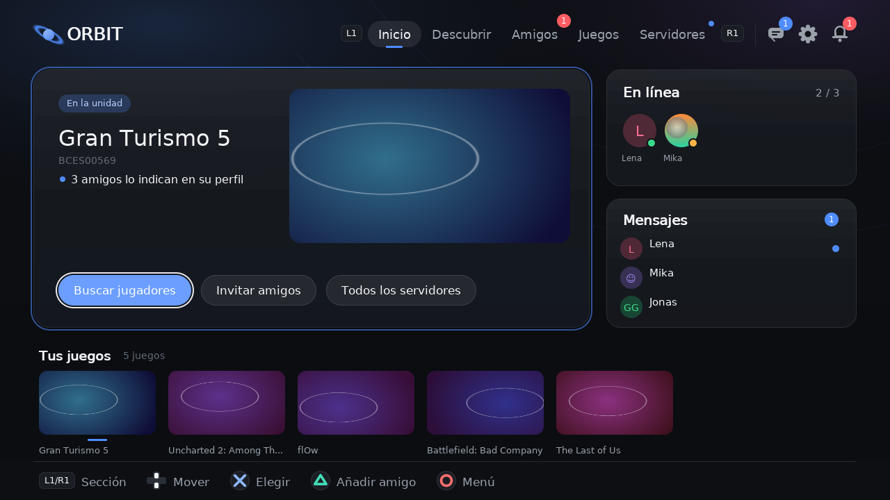
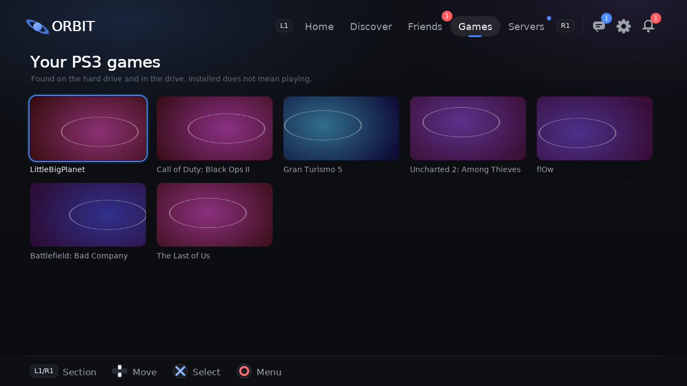
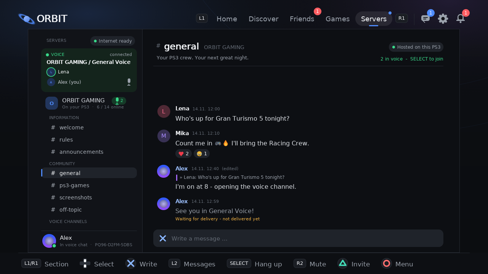
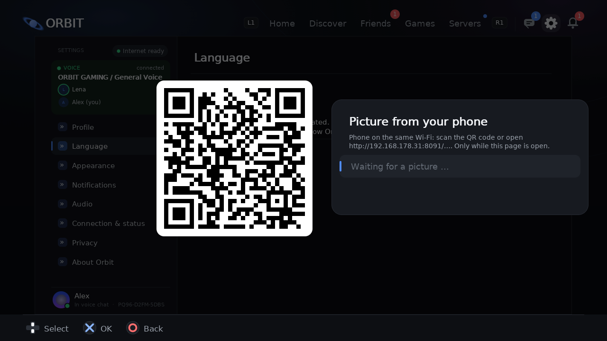

 

**Texto. Voz. Amigos. Comunidades. Una PS3 conectada de verdad.**

[English](README.md) · [Deutsch](README-DE.md) · [Français](README-FR.md) · **Español**

[**⬇ Descargar ORBIT 1.2.0**](https://github.com/C2V4ZA/ORBIT/releases/tag/v1.2.0) &nbsp;·&nbsp; [Instalación](docs/INSTALLATION.md) &nbsp;·&nbsp; [Funciones](docs/FEATURES.md) &nbsp;·&nbsp; [FAQ](docs/FAQ.md) &nbsp;·&nbsp; [Cambios](CHANGELOG.md)

---

> [!IMPORTANT]
> **Nueva cuenta oficial.** ORBIT se publicó primero por su creador en la cuenta de GitHub **C2V3ZA**. El acceso a esa cuenta se perdió por un problema con su correo electrónico y la cuenta fue eliminada. **C2V4ZA es la nueva cuenta oficial del mismo creador**: no es un fork ni una copia, y ORBIT no está abandonado. [Leer el anuncio completo](docs/ACCOUNT-MIGRATION.md#español).

## ¿Qué es ORBIT?

ORBIT es una aplicación homebrew independiente que lleva la comunicación moderna a la PlayStation 3: chat de texto, chat de voz, amigos, mensajes privados y servidores de comunidad con canales y roles, directamente de PS3 a PS3.

- **Sin cuenta, sin contraseña.** Cada PS3 se identifica con su propia clave secreta.
- **Sin ajustes del router, sin PC.** En la misma red, las consolas se encuentran solas; por Internet, ORBIT abre su propio túnel.
- **Tus datos se quedan en las PS3.** Cada servidor vive en la PS3 que lo creó. No existe ningún servidor de empresa de ORBIT.
- **Habla tu idioma.** 9 idiomas, elegidos automáticamente según el idioma del sistema de la PS3.

 Inicio de ORBIT 1.2.0, generado por el propio código de interfaz de la aplicación con datos de ejemplo.

## Novedades de la 1.2.0

| | |
|---|---|
| **Nueva interfaz** | Diseño de cristal, barra superior común (L1/R1), inicio Spotlight, 8 temas, nueva intro, sonidos, teclado de emojis, No molestar |
| **Descubrir** | Comunidades públicas en PS3 conectadas: búsqueda, filtros, orden, detalles, indicadores en línea/desconectado, lista guardada cuando un anfitrión está desconectado |
| **Juegos** | Tus juegos de PS3 instalados, y qué amigos los indican o los están jugando |
| **Notificaciones en segundo plano** | Los mensajes nuevos aparecen arriba a la derecha en el XMB y en los juegos, incluso con ORBIT cerrado (plugin) |
| **Fotos de perfil** | Desde un USB o desde tu **móvil** (escanea el código QR) |
| **Imágenes animadas** | Avatares GIF e iconos de servidor (máx. 10 fps, 15 s, 150 fotogramas), pausa con carga alta, ajuste *Reducir movimiento* |
| **Apariencia del servidor** | Icono fijo o animado, símbolo, color, banner, restablecer, vista previa con recorte, **registro de cambios**: solo el propietario y los roles con *Gestionar servidor*, comprobado por el anfitrión |
| **Moderación** | Denuncias, lista de denuncias para moderadores, expulsiones temporales (1 / 7 / 30 días / hasta retirarlas), filtro de nombres |
| **Idiomas** | Español, English, Deutsch, Français, Italiano, Português, **Русский, Українська, Norsk bokmål**: formas de plural, teclados cirílico y nórdico, sugerencias de palabras locales |
| **Actualizaciones firmadas** | ORBIT busca actualizaciones firmadas con Ed25519; nada se instala solo |

Todo lo de la 1.0.3 sigue ahí: amigos, chats privados y de grupo, mensajes sin conexión, servidores de comunidad con categorías, roles y permisos, canales de voz, perfiles. Lista completa: [CHANGELOG.md](CHANGELOG.md)

> [!NOTE]
> **La 1.2.0 es nueva.** Las notificaciones en segundo plano se confirmaron en una PS3 real. La mayoría de las demás funciones de la 1.2 se probaron en el PC (pruebas automáticas, sanitizers, fuzzing) y aún se están probando en una PS3 real. Informa de los problemas en [Issues](https://github.com/C2V4ZA/ORBIT/issues).

## Capturas de pantalla

<table>
<tr>
<td width="50%"> <b>Descubrir</b>: encuentra comunidades de PS3, incluso con el anfitrión desconectado</td>
<td width="50%"> <b>Juegos</b>: tus juegos de PS3 y a qué juegan tus amigos</td>
</tr>
<tr>
<td> <b>Servidores de comunidad</b>: canales, roles, voz</td>
<td> <b>Foto desde tu móvil</b>: escanea, elige, listo</td>
</tr>
</table>

Todas las capturas proceden del motor de interfaz de ORBIT 1.2.0 (el mismo código C que se ejecuta en la PS3) con nombres y mensajes de ejemplo.

## Idiomas

Completos: **Español, English, Deutsch, Français, Italiano, Português, Русский, Українська, Norsk bokmål**.

La página de idioma también muestra los idiomas que **aún no están disponibles**, y por qué: el japonés, el coreano, el chino y el hindi necesitan una fuente que ORBIT todavía no incluye; el árabe necesita texto de derecha a izquierda y unión de letras; los demás idiomas europeos aún no están traducidos. ORBIT nunca marca un idioma como completo si no lo está.

## Próximamente: servidores 24/7

Hoy un servidor solo está en línea mientras ORBIT se ejecuta en la PS3 anfitriona. Estamos trabajando en un **servidor ORBIT siempre activo**: las comunidades **seguirán en línea aunque la PS3 del anfitrión esté apagada**, con mensajes, miembros y canales accesibles a cualquier hora. Será opcional; ORBIT seguirá funcionando de PS3 a PS3 como hasta ahora.

## Descargar e instalar

1. Descarga **[Orbit-PS3-1.2.0.pkg](https://github.com/C2V4ZA/ORBIT/releases/tag/v1.2.0)** (ID de título `ORB000001`).
2. Cópialo a un USB en FAT32 e instálalo con el **Package Manager** en una PS3 con **CFW o HEN**.
3. Abre **Orbit Chat** desde la columna Juego.

Tus datos de la 1.0.x se conservan. Guía detallada (inglés): **[docs/INSTALLATION.md](docs/INSTALLATION.md)**

> [!WARNING]
> Al actualizar se conservan tus amigos, servidores, mensajes y nombre. **No es posible volver a una versión anterior.**

## Conviene saber

- Un servidor solo es accesible mientras ORBIT se ejecuta en la PS3 que lo aloja (los servidores 24/7 están previstos, ver arriba).
- Las conexiones entre consolas están cifradas, pero **la PS3 anfitriona puede leer los mensajes de sus propios servidores y chats privados**: ORBIT no promete cifrado de extremo a extremo. Ver [docs/PRIVACY.md](docs/PRIVACY.md).
- Las imágenes se comprueban con los lectores estrictos de PNG, JPEG y GIF de ORBIT; solo una versión recodificada de 96 × 96 sale de tu PS3, nunca el archivo original.
- No hay chat de voz durante un juego (la PS3 ejecuta una sola aplicación a la vez). Las notificaciones en segundo plano sí funcionan en los juegos.
- El micrófono del mando de PS5 se puede usar para hablar; su altavoz no puede reproducir el chat de voz. Detalles: [docs/AUDIO.md](docs/AUDIO.md)
- Todos los límites y problemas conocidos: [docs/FAQ.md](docs/FAQ.md) · [docs/TROUBLESHOOTING.md](docs/TROUBLESHOOTING.md)

## Creado con ayuda de IA

ORBIT se ha desarrollado con **una amplia ayuda de inteligencia artificial**: arquitectura, programación en C, funciones, interfaz, red, audio, búsqueda de errores, pruebas, traducciones, documentación y preparación de versiones. La idea, la dirección creativa y las decisiones importantes vienen del creador humano, que prueba las versiones en hardware real de PlayStation 3. Lo decimos abiertamente porque debes saber cómo se ha creado el software que instalas.

## Licencia y aviso legal

ORBIT es software libre bajo la [GPL-3.0-or-later](LICENSE). Componentes de terceros y sus licencias: [THIRD-PARTY.md](THIRD-PARTY.md).

ORBIT es un proyecto homebrew independiente y **no está afiliado, respaldado ni vinculado a Sony Interactive Entertainment**. «PlayStation» y «PS3» son marcas de sus respectivos propietarios y se usan aquí solo para describir la compatibilidad.

  ORBIT — Volver a conectar a los jugadores de PlayStation 3.

