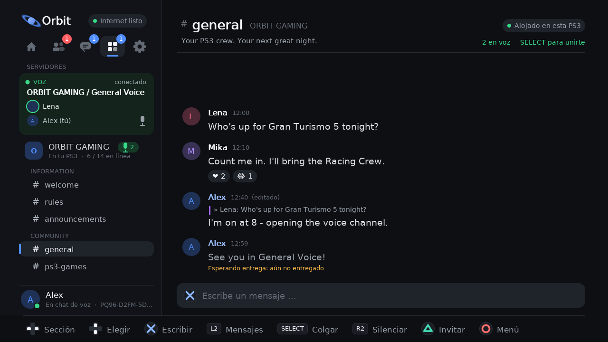
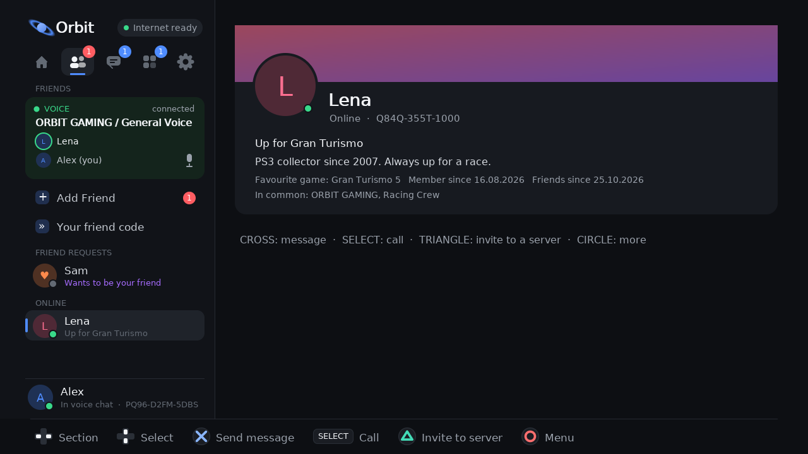

 

**Texto. Voz. Amigos. Comunidades. Una PS3 conectada de verdad.**

[English](README.md) · [Deutsch](README-DE.md) · [Français](README-FR.md) · **Español**

[**⬇ Descargar ORBIT 1.0.3**](https://github.com/C2V4ZA/ORBIT/releases/tag/v1.0.3) &nbsp;·&nbsp; [Instalación](docs/INSTALLATION.md) &nbsp;·&nbsp; [Funciones](docs/FEATURES.md) &nbsp;·&nbsp; [FAQ](docs/FAQ.md)

---

> [!IMPORTANT]
> **Nueva cuenta oficial.** ORBIT se publicó primero por su creador en la cuenta de GitHub **C2V3ZA**. El acceso a esa cuenta se perdió por un problema con su correo electrónico y la cuenta fue eliminada. **C2V4ZA es la nueva cuenta oficial del mismo creador**: no es un fork ni una copia, y ORBIT no está abandonado. [Leer el anuncio completo](docs/ACCOUNT-MIGRATION.md#español).

## ¿Qué es ORBIT?

ORBIT es una aplicación homebrew independiente que lleva la comunicación moderna a la PlayStation 3: chat de texto, chat de voz, amigos, mensajes privados y servidores de comunidad con canales y roles, directamente de PS3 a PS3.

- **Sin cuenta ni contraseña.** Cada PS3 inicia sesión con su propia clave secreta.
- **Sin tocar el router ni usar un PC.** En la misma red las consolas se encuentran solas; por internet ORBIT abre su propio túnel.
- **Tus datos se quedan en las PS3.** Cada servidor vive en la PS3 que lo creó. No existe un servidor de empresa de ORBIT.
- **Habla tu idioma.** La interfaz sigue el idioma del sistema de la PS3: español, inglés, alemán o francés.

 Servidor de comunidad en ORBIT 1.0.3, generado por el código de interfaz real de la aplicación con datos de ejemplo.

## Novedades de la 1.0.3

| | |
|---|---|
| **Amigos** | Código de amigo de 20 caracteres, solicitudes, aceptar/rechazar, eliminar, bloquear, un ID de Orbit permanente por PS3 |
| **Mensajes** | Chats privados y de grupo, respuestas, edición, borrado, 6 reacciones, búsqueda, silenciar, marcas de tiempo |
| **Mensajes sin conexión** | Los mensajes esperan en tu PS3 («Esperando entrega») y se entregan cuando la otra PS3 está disponible |
| **Servidores de comunidad** | Categorías, canales de texto y voz, plantillas, descripción, mensaje de bienvenida, icono, color, banner, público o privado |
| **Roles y permisos** | Owner, Admin, Moderator, Member + roles propios, 10 permisos, comprobados por la PS3 anfitriona |
| **Canales de voz** | Cambiar de canal, silenciar a alguien solo para ti, volumen por persona de 0 a 200 %, silencio de servidor por moderadores |
| **Perfiles** | Avatar, color, sobre mí, juego favorito, estado personalizado, En línea / Ausente / Ocupado / Invisible |
| **Notificaciones** | Solicitudes, mensajes privados, menciones, llamadas, invitaciones, moderación; cada tipo se puede desactivar |
| **Temas** | Dark, Blue, Purple, Minimal |
| **Idiomas** | Español, inglés, alemán, francés, automáticamente según el idioma de la PS3 |

Lista completa: [docs/FEATURES.md](docs/FEATURES.md) (inglés)

## Capturas de pantalla

<table>
<tr>
<td width="50%"> <b>Inicio</b>: amigos, chats y servidores de un vistazo</td>
<td width="50%"> <b>Amigos</b>: perfil, estado, ID de Orbit, servidores en común</td>
</tr>
<tr>
<td> <b>Mensajes</b>: chats privados y de grupo</td>
<td> <b>Servidores de comunidad</b>: resumen, miembros, roles</td>
</tr>
<tr>
<td> <b>Chat de voz</b>: canales de voz con participantes</td>
<td> <b>Ajustes</b>: idioma, apariencia, notificaciones, audio, privacidad</td>
</tr>
</table>

Todas las capturas proceden del motor de interfaz de ORBIT 1.0.3 (el mismo código C que en la PS3) con nombres y mensajes de ejemplo.

## Descargar e instalar

1. Descarga **[Orbit-PS3-1.0.3.pkg](https://github.com/C2V4ZA/ORBIT/releases/tag/v1.0.3)** (ID de título `ORB000001`).
2. Cópialo a un USB en FAT32 e instálalo con el **Package Manager** en una PS3 con **CFW o HEN**.
3. Abre **Orbit Chat** desde la columna Juego y confirma tu nombre.

Guía detallada: **[docs/INSTALLATION.md](docs/INSTALLATION.md)** (inglés)

> [!WARNING]
> Al actualizar desde la 0.9.5 se conservan grupos, mensajes y nombre; los grupos se convierten en servidores. **No es posible volver de la 1.0.3 a la 0.9.5.**

## Mando PS5

Puedes utilizar el micrófono del mando PS5 para hablar en ORBIT. Sin embargo, las voces de otros participantes no se pueden reproducir a través del altavoz integrado del mando. Utiliza el televisor u otra salida de audio compatible. Más: [docs/AUDIO.md](docs/AUDIO.md)

## Conviene saber

- Un servidor solo está disponible mientras ORBIT se ejecuta en la PS3 que lo aloja.
- Las conexiones entre consolas están cifradas, pero **la PS3 anfitriona puede leer los mensajes de sus propios servidores y chats privados**: ORBIT no promete cifrado de extremo a extremo estricto. Ver [docs/PRIVACY.md](docs/PRIVACY.md).
- No hay chat de voz durante un juego (la PS3 ejecuta una sola aplicación a la vez).
- Límites y problemas conocidos: [docs/FAQ.md](docs/FAQ.md) · [docs/TROUBLESHOOTING.md](docs/TROUBLESHOOTING.md)

## Desarrollado con ayuda de IA

ORBIT se ha desarrollado con **una ayuda amplia de inteligencia artificial**: arquitectura, programación en C, funciones, interfaz, red, audio, búsqueda de errores, pruebas, traducciones, documentación y preparación de versiones. La idea, la dirección creativa y las decisiones importantes son del creador humano, que además prueba cada versión en una PlayStation 3 real. Lo decimos abiertamente porque tienes derecho a saber cómo se hizo el software que instalas.

## Licencia y aviso legal

ORBIT es software libre bajo la licencia [GPL-3.0-or-later](LICENSE). Componentes de terceros y sus licencias: [THIRD-PARTY.md](THIRD-PARTY.md).

ORBIT es un proyecto homebrew independiente y **no tiene relación con Sony Interactive Entertainment**. «PlayStation» y «PS3» son marcas de sus respectivos propietarios y se mencionan solo para describir la compatibilidad.

  ORBIT — Volviendo a conectar a los jugadores de PlayStation 3.

