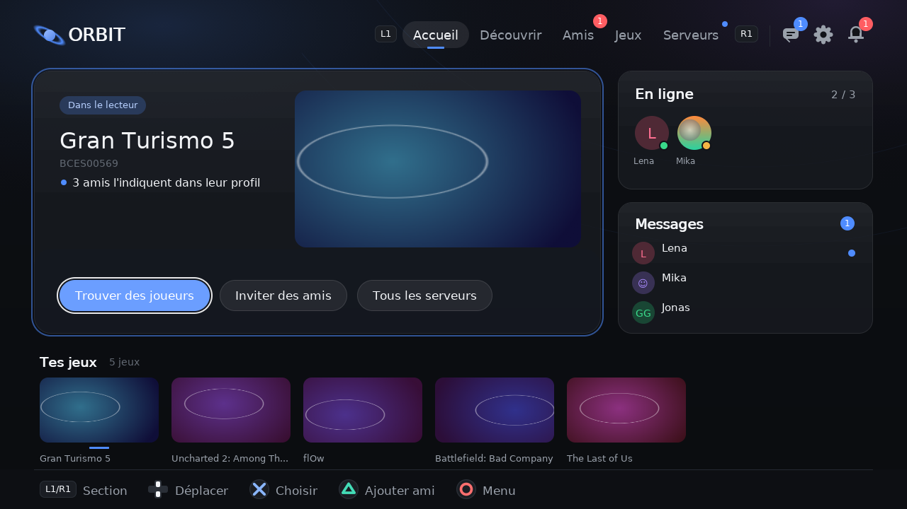

 

**Texte. Voix. Amis. Communautés. Une PS3 enfin connectée.**

[English](README.md) · [Deutsch](README-DE.md) · **Français** · [Español](README-ES.md)

[**⬇ Télécharger ORBIT 1.2.0**](https://github.com/C2V4ZA/ORBIT/releases/tag/v1.2.0) &nbsp;·&nbsp; [Installation](docs/INSTALLATION.md) &nbsp;·&nbsp; [Fonctions](docs/FEATURES.md) &nbsp;·&nbsp; [FAQ](docs/FAQ.md) &nbsp;·&nbsp; [Historique](CHANGELOG.md)

---

> [!IMPORTANT]
> **Nouveau compte officiel.** ORBIT a d'abord été publié par son créateur sous le compte GitHub **C2V3ZA**. L'accès à ce compte a été perdu à cause d'un problème avec son adresse e-mail, puis le compte a été supprimé. **C2V4ZA est le nouveau compte officiel du même créateur** – ce n'est ni un fork ni une copie, et ORBIT n'est pas abandonné. [Lire l'annonce complète](docs/ACCOUNT-MIGRATION.md#français).

## Qu'est-ce qu'ORBIT ?

ORBIT est une application homebrew indépendante qui apporte une communication moderne à la PlayStation 3 : chat textuel, chat vocal, amis, messages privés et serveurs communautaires avec salons et rôles – directement de PS3 à PS3.

- **Sans compte, sans mot de passe.** Chaque PS3 se connecte avec sa propre clé secrète.
- **Sans réglage du routeur, sans PC.** Sur le même réseau, les consoles se trouvent seules ; par Internet, ORBIT ouvre son propre tunnel.
- **Tes données restent sur des PS3.** Chaque serveur est hébergé par la PS3 qui l'a créé. Il n'y a pas de serveur d'entreprise ORBIT.
- **Parle ta langue.** 9 langues, choisies automatiquement selon la langue système de la PS3.

 Accueil d'ORBIT 1.2.0 – rendu par le vrai code d'interface de l'application avec des données d'exemple.

## Nouveautés de la 1.2.0

| | |
|---|---|
| **Nouvelle interface** | Design en verre, barre supérieure commune (L1/R1), accueil Spotlight, 8 thèmes, nouvelle intro, sons, clavier emoji, Ne pas déranger |
| **Découvrir** | Communautés publiques sur les PS3 connectées – recherche, filtres, tri, détails, badges en ligne/hors ligne, liste enregistrée quand un hôte est hors ligne |
| **Jeux** | Tes jeux PS3 installés, et quels amis les indiquent ou y jouent |
| **Notifications en arrière-plan** | Les nouveaux messages s'affichent en haut à droite dans le XMB et en jeu – même quand ORBIT est fermé (plugin) |
| **Photos de profil** | Depuis une clé USB ou depuis ton **téléphone** (scanne le QR code) |
| **Images animées** | Avatars GIF et icônes de serveur (max. 10 img/s, 15 s, 150 images), pause en cas de charge, réglage *Réduire les animations* |
| **Apparence du serveur** | Icône fixe ou animée, symbole, couleur, bannière, réinitialisation, aperçu avec recadrage, **journal des modifications** – seulement le propriétaire et les rôles *Gérer le serveur*, vérifié par l'hôte |
| **Modération** | Signalements, liste des signalements pour les modérateurs, bannissements temporaires (1 / 7 / 30 jours / jusqu'à levée), filtre de noms |
| **Langues** | Français, English, Deutsch, Español, Italiano, Português, **Русский, Українська, Norsk bokmål** – formes du pluriel, claviers cyrillique et nordique, suggestions de mots locales |
| **Mises à jour signées** | ORBIT recherche des mises à jour signées Ed25519 ; rien ne s'installe tout seul |

Tout ce qui existait dans la 1.0.3 est toujours là : amis, discussions privées et de groupe, messages hors ligne, serveurs communautaires avec catégories, rôles et permissions, salons vocaux, profils. Liste complète : [CHANGELOG.md](CHANGELOG.md)

> [!NOTE]
> **La 1.2.0 est nouvelle.** Les notifications en arrière-plan ont été confirmées sur une vraie PS3. La plupart des autres fonctions 1.2 ont été testées sur PC (tests automatiques, sanitizers, fuzzing) et sont encore en cours de test sur une vraie PS3. Merci de signaler les problèmes dans les [Issues](https://github.com/C2V4ZA/ORBIT/issues).

## Captures d'écran

<table>
<tr>
<td width="50%"> <b>Découvrir</b> – trouve des communautés PS3, même quand un hôte est hors ligne</td>
<td width="50%"> <b>Jeux</b> – tes jeux PS3 et ce à quoi jouent tes amis</td>
</tr>
<tr>
<td> <b>Serveurs communautaires</b> – salons, rôles, voix</td>
<td> <b>Photo depuis ton téléphone</b> – scanne, choisis, c'est fait</td>
</tr>
</table>

Toutes les captures proviennent du moteur d'interface d'ORBIT 1.2.0 (le même code C que sur la PS3) avec des noms et messages d'exemple.

## Langues

Complètes : **Français, English, Deutsch, Español, Italiano, Português, Русский, Українська, Norsk bokmål**.

La page Langue indique aussi les langues **pas encore disponibles**, et pourquoi : le japonais, le coréen, le chinois et le hindi ont besoin d'une police qu'ORBIT ne fournit pas encore ; l'arabe a besoin du texte de droite à gauche et de la liaison des lettres ; les autres langues européennes ne sont pas encore traduites. ORBIT n'indique jamais une langue comme complète si elle ne l'est pas.

## Bientôt : serveurs 24/7

Aujourd'hui, un serveur n'est en ligne que tant qu'ORBIT tourne sur la PS3 hôte. Nous travaillons sur un **serveur ORBIT toujours actif** : les communautés **resteront en ligne même quand la PS3 de l'hôte est éteinte** – messages, membres et salons accessibles jour et nuit. Il sera facultatif ; ORBIT continue de fonctionner de PS3 à PS3 comme avant.

## Télécharger & installer

1. Télécharge **[Orbit-PS3-1.2.0.pkg](https://github.com/C2V4ZA/ORBIT/releases/tag/v1.2.0)** (ID de titre `ORB000001`).
2. Copie-le sur une clé USB en FAT32 et installe-le avec le **Package Manager** sur une PS3 sous **CFW ou HEN**.
3. Lance **Orbit Chat** depuis la colonne Jeu.

Tes données de la 1.0.x sont conservées. Guide détaillé (anglais) : **[docs/INSTALLATION.md](docs/INSTALLATION.md)**

> [!WARNING]
> La mise à jour conserve tes amis, serveurs, messages et ton nom. **Revenir à une ancienne version n'est pas possible.**

## Bon à savoir

- Un serveur n'est joignable que tant qu'ORBIT tourne sur la PS3 qui l'héberge (les serveurs 24/7 sont prévus, voir ci-dessus).
- Les connexions entre consoles sont chiffrées, mais **la PS3 hôte peut lire les messages de ses propres serveurs et discussions privées** – ORBIT ne promet pas de chiffrement de bout en bout. Voir [docs/PRIVACY.md](docs/PRIVACY.md).
- Les images sont vérifiées par les lecteurs PNG, JPEG et GIF stricts d'ORBIT ; seule une version réencodée en 96 × 96 quitte ta PS3, jamais le fichier original.
- Pas de chat vocal pendant un jeu (la PS3 n'exécute qu'une application à la fois). Les notifications en arrière-plan fonctionnent en jeu.
- Le micro de la manette PS5 peut être utilisé pour parler ; son haut-parleur ne peut pas lire le chat vocal. Détails : [docs/AUDIO.md](docs/AUDIO.md)
- Toutes les limites et problèmes connus : [docs/FAQ.md](docs/FAQ.md) · [docs/TROUBLESHOOTING.md](docs/TROUBLESHOOTING.md)

## Créé avec l'aide de l'IA

ORBIT a été développé avec **une aide importante de l'intelligence artificielle** : architecture, programmation C, fonctions, interface, réseau, audio, recherche de bugs, tests, traductions, documentation et préparation des versions. L'idée, la direction créative et les décisions importantes viennent du créateur humain, qui teste les versions sur une vraie PlayStation 3. Nous le disons ouvertement, car tu dois savoir comment a été créé le logiciel que tu installes.

## Licence & mentions légales

ORBIT est un logiciel libre sous licence [GPL-3.0-or-later](LICENSE). Composants tiers et leurs licences : [THIRD-PARTY.md](THIRD-PARTY.md).

ORBIT est un projet homebrew indépendant et **n'est ni affilié à, ni approuvé par Sony Interactive Entertainment**. « PlayStation » et « PS3 » sont des marques de leurs propriétaires respectifs, utilisées ici uniquement pour décrire la compatibilité.

  ORBIT — Reconnecter les joueurs PlayStation 3.

