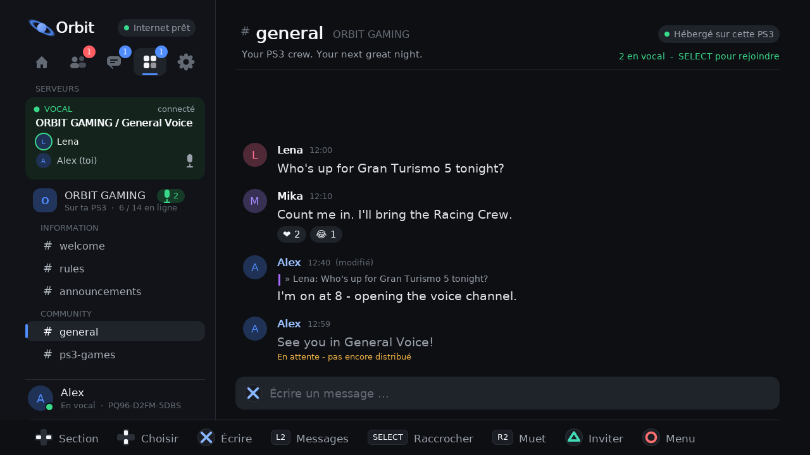
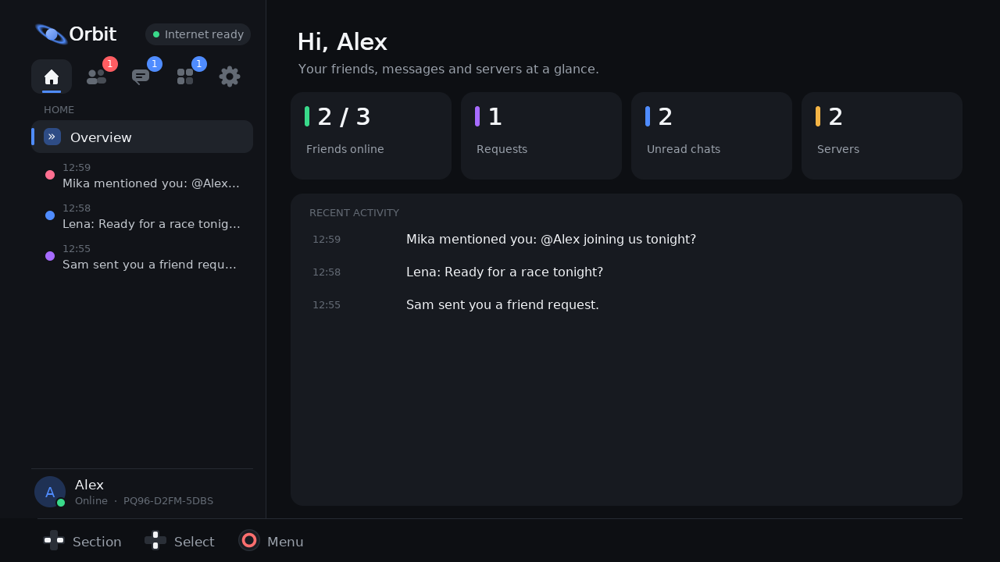
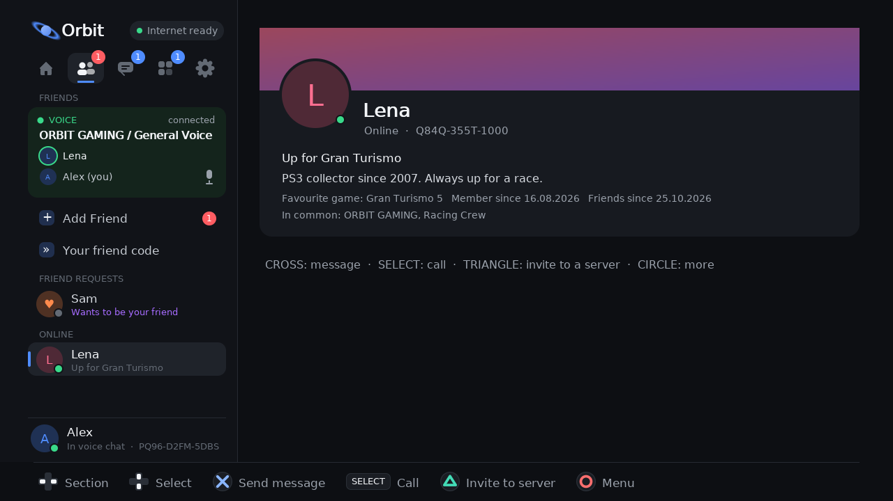
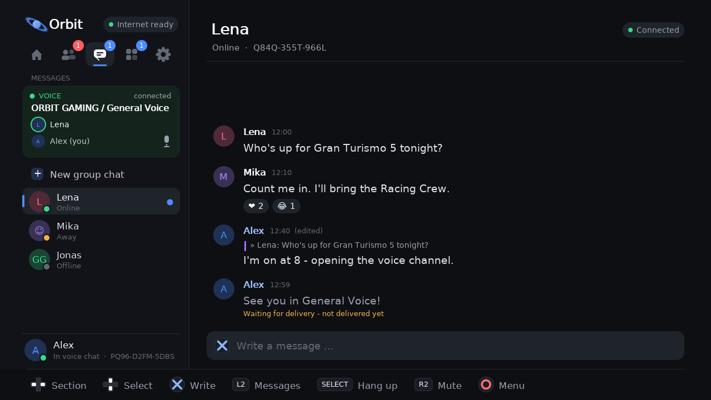
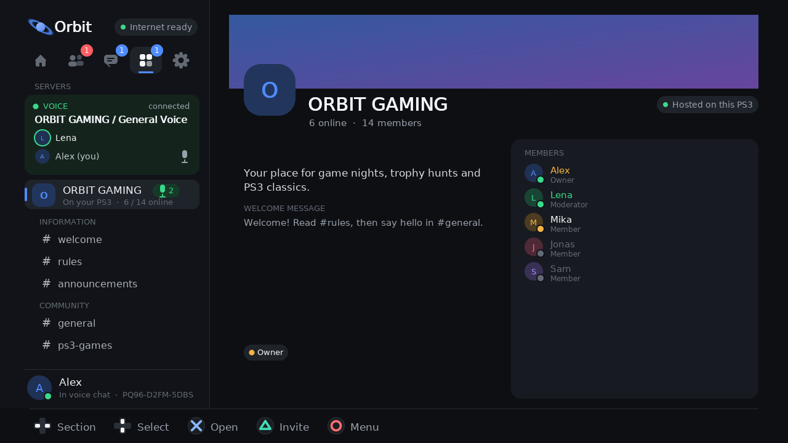
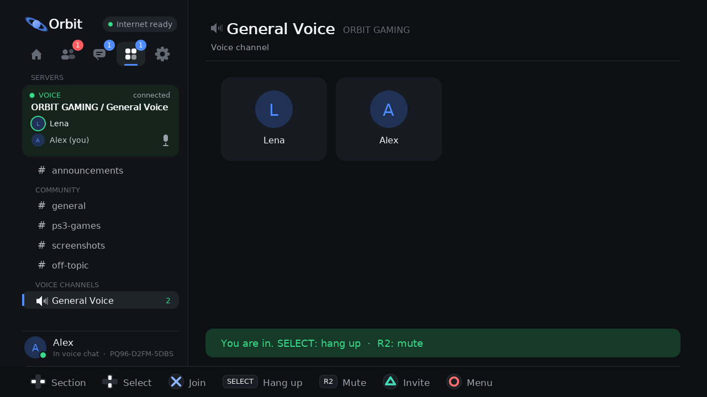
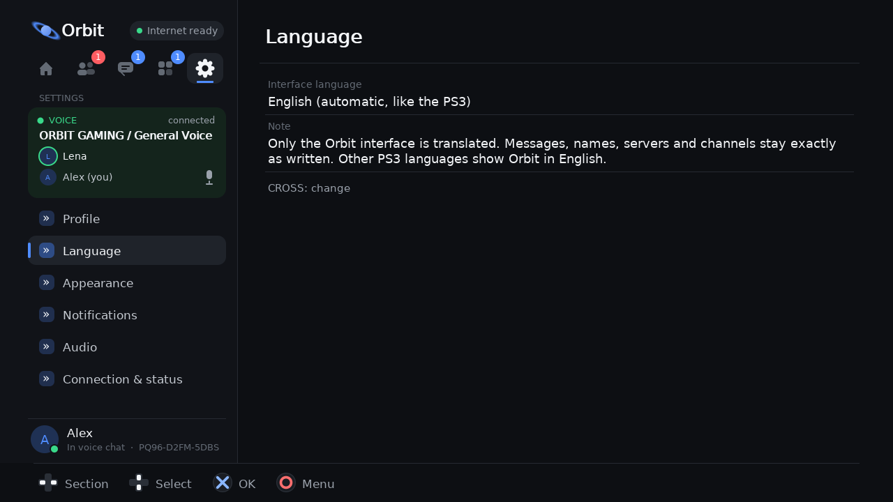

 

**Texte. Voix. Amis. Communautés. Une PS3 enfin connectée.**

[English](README.md) · [Deutsch](README-DE.md) · **Français** · [Español](README-ES.md)

[**⬇ Télécharger ORBIT 1.0.3**](https://github.com/C2V4ZA/ORBIT/releases/tag/v1.0.3) &nbsp;·&nbsp; [Installation](docs/INSTALLATION.md) &nbsp;·&nbsp; [Fonctions](docs/FEATURES.md) &nbsp;·&nbsp; [FAQ](docs/FAQ.md)

---

> [!IMPORTANT]
> **Nouveau compte officiel.** ORBIT a d'abord été publié par son créateur sous le compte GitHub **C2V3ZA**. L'accès à ce compte a été perdu à cause d'un problème avec son adresse e-mail, puis le compte a été supprimé. **C2V4ZA est le nouveau compte officiel du même créateur** – ce n'est ni un fork ni une copie, et ORBIT n'est pas abandonné. [Lire l'annonce complète](docs/ACCOUNT-MIGRATION.md#français).

## Qu'est-ce qu'ORBIT ?

ORBIT est une application homebrew indépendante qui apporte une communication moderne à la PlayStation 3 : chat textuel, chat vocal, amis, messages privés et serveurs communautaires avec salons et rôles – directement de PS3 à PS3.

- **Sans compte, sans mot de passe.** Chaque PS3 se connecte avec sa propre clé secrète.
- **Sans réglage du routeur, sans PC.** Sur le même réseau, les consoles se trouvent seules ; par Internet, ORBIT ouvre son propre tunnel.
- **Tes données restent sur des PS3.** Chaque serveur est hébergé par la PS3 qui l'a créé. Il n'y a pas de serveur d'entreprise ORBIT.
- **Parle ta langue.** L'interface suit la langue système de la PS3 : français, anglais, allemand ou espagnol.

 Serveur communautaire dans ORBIT 1.0.3 – rendu par le vrai code d'interface de l'application avec des données d'exemple.

## Nouveautés de la 1.0.3

| | |
|---|---|
| **Amis** | Code ami de 20 caractères, demandes, accepter/refuser, retirer, bloquer, un ID Orbit permanent par PS3 |
| **Messages** | Discussions privées et de groupe, réponses, modification, suppression, 6 réactions, recherche, sourdine, horodatage |
| **Messages hors ligne** | Les messages attendent sur ta PS3 (« En attente ») et sont distribués dès que l'autre PS3 est joignable |
| **Serveurs communautaires** | Catégories, salons textuels et vocaux, modèles, description, message de bienvenue, icône, couleur, bannière, public ou privé |
| **Rôles et permissions** | Owner, Admin, Moderator, Member + rôles personnalisés, 10 permissions – vérifiées par la PS3 hôte |
| **Salons vocaux** | Changer de salon, couper quelqu'un pour soi, volume par personne de 0 à 200 %, mise en sourdine par les modérateurs |
| **Profils** | Avatar, couleur, à propos, jeu préféré, statut personnalisé, En ligne / Absent / Occupé / Invisible |
| **Notifications** | Demandes d'ami, messages privés, mentions, appels, invitations, modération – chaque type peut être désactivé |
| **Thèmes** | Dark, Blue, Purple, Minimal |
| **Langues** | Français, anglais, allemand, espagnol – automatiquement selon la langue de la PS3 |

Liste complète : [docs/FEATURES.md](docs/FEATURES.md) (anglais)

## Captures d'écran

<table>
<tr>
<td width="50%"> <b>Accueil</b> – amis, chats et serveurs en un coup d'œil</td>
<td width="50%"> <b>Amis</b> – profil, statut, ID Orbit, serveurs en commun</td>
</tr>
<tr>
<td> <b>Messages</b> – discussions privées et de groupe</td>
<td> <b>Serveurs communautaires</b> – vue d'ensemble, membres, rôles</td>
</tr>
<tr>
<td> <b>Chat vocal</b> – salons vocaux avec participants</td>
<td> <b>Paramètres</b> – langue, apparence, notifications, audio, confidentialité</td>
</tr>
</table>

Toutes les captures proviennent du moteur d'interface d'ORBIT 1.0.3 (le même code C que sur la PS3) avec des noms et messages d'exemple.

## Télécharger et installer

1. Télécharge **[Orbit-PS3-1.0.3.pkg](https://github.com/C2V4ZA/ORBIT/releases/tag/v1.0.3)** (ID de titre `ORB000001`).
2. Copie-le sur une clé USB FAT32 et installe-le avec le **Package Manager** sur une PS3 en **CFW ou HEN**.
3. Lance **Orbit Chat** depuis la colonne Jeu et confirme ton nom.

Guide détaillé : **[docs/INSTALLATION.md](docs/INSTALLATION.md)** (anglais)

> [!WARNING]
> La mise à jour depuis la 0.9.5 conserve groupes, messages et nom – les groupes deviennent des serveurs. **Revenir de la 1.0.3 à la 0.9.5 n'est pas possible.**

## Manette PS5

Le microphone de la manette PS5 peut être utilisé pour parler dans ORBIT. Cependant, les voix des autres participants ne peuvent pas être diffusées par le haut-parleur intégré de la manette. Utilisez votre téléviseur ou une autre sortie audio compatible. Plus : [docs/AUDIO.md](docs/AUDIO.md)

## Bon à savoir

- Un serveur n'est joignable que tant qu'ORBIT tourne sur la PS3 qui l'héberge.
- Les connexions entre consoles sont chiffrées, mais **la PS3 hôte peut lire les messages de ses propres serveurs et discussions privées** – ORBIT ne promet pas de chiffrement de bout en bout strict. Voir [docs/PRIVACY.md](docs/PRIVACY.md).
- Pas de chat vocal pendant un jeu (la PS3 n'exécute qu'une application à la fois).
- Limites et problèmes connus : [docs/FAQ.md](docs/FAQ.md) · [docs/TROUBLESHOOTING.md](docs/TROUBLESHOOTING.md)

## Développé avec l'aide de l'IA

ORBIT a été développé avec **une aide importante de l'intelligence artificielle** : architecture, programmation en C, fonctionnalités, interface, réseau, audio, recherche de bugs, tests, traductions, documentation et préparation des versions. L'idée, la direction créative et les décisions importantes viennent du créateur humain, qui teste aussi chaque version sur une vraie PlayStation 3. Nous le disons ouvertement, car tu as le droit de savoir comment le logiciel que tu installes a été créé.

## Licence et mentions légales

ORBIT est un logiciel libre sous licence [GPL-3.0-or-later](LICENSE). Composants tiers et licences : [THIRD-PARTY.md](THIRD-PARTY.md).

ORBIT est un projet homebrew indépendant, **sans aucun lien avec Sony Interactive Entertainment**. « PlayStation » et « PS3 » sont des marques de leurs propriétaires respectifs, citées uniquement pour décrire la compatibilité.

  ORBIT — Reconnecter les joueurs PlayStation 3.

