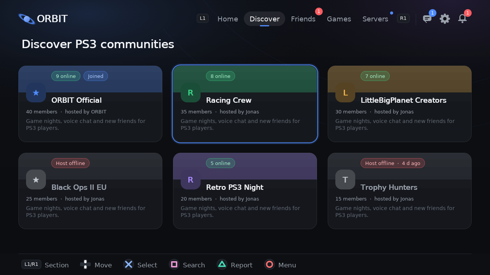
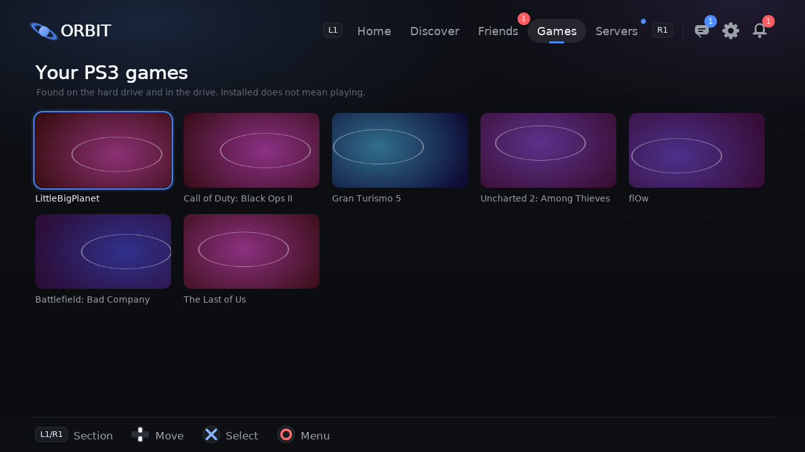
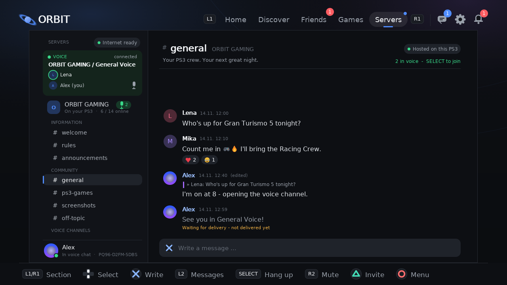
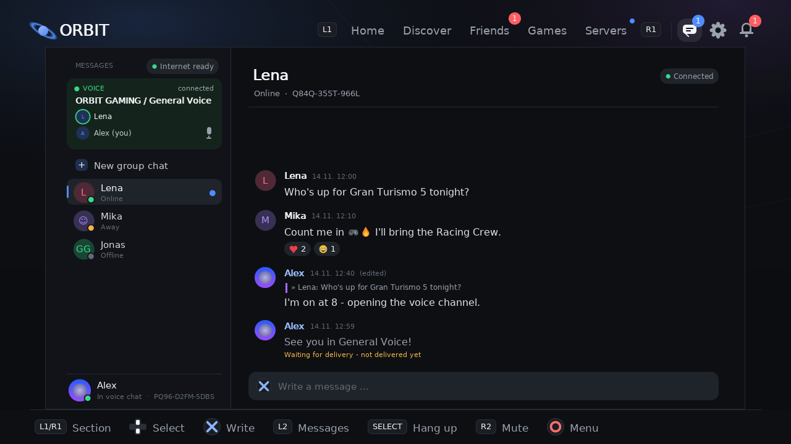
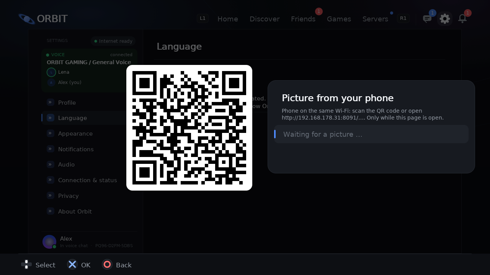
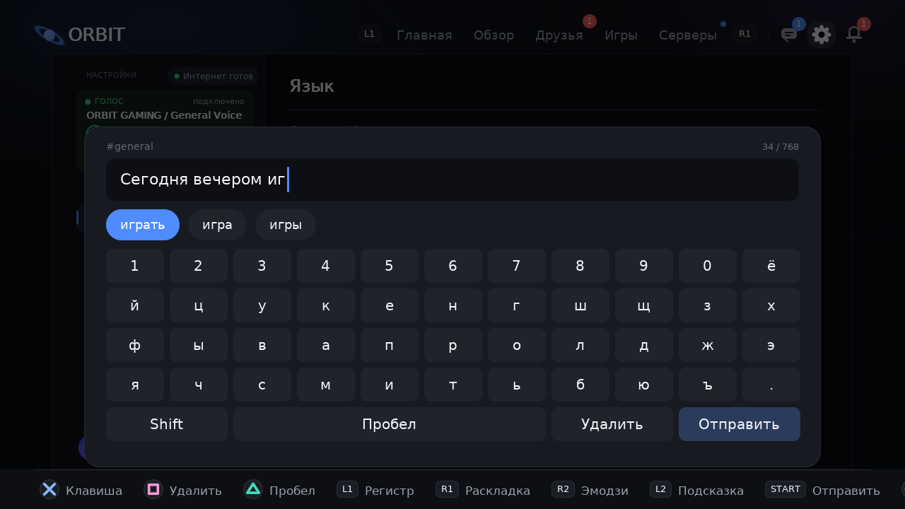
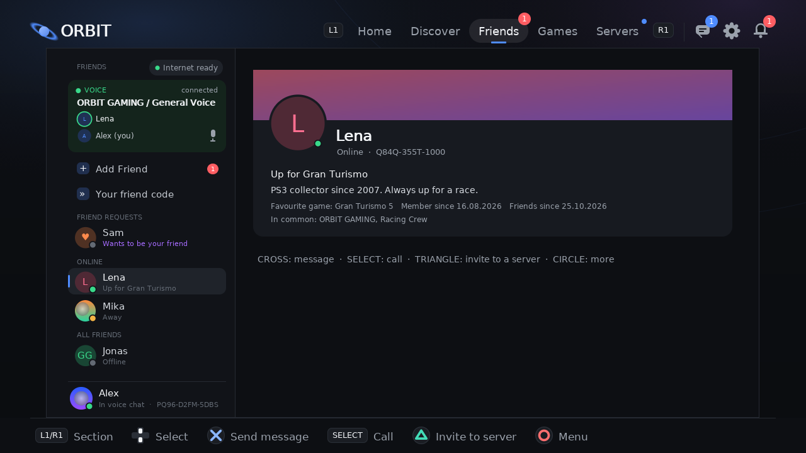
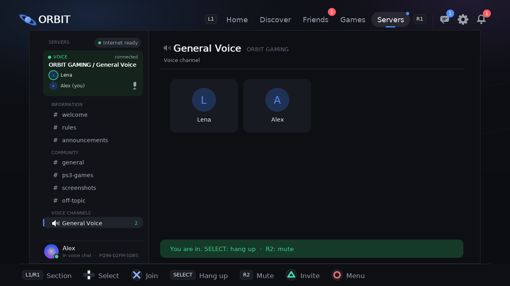

 

**Text. Voice. Friends. Communities. One connected PS3 experience.**

**English** · [Deutsch](README-DE.md) · [Français](README-FR.md) · [Español](README-ES.md)

[**⬇ Download ORBIT 1.2.0**](https://github.com/C2V4ZA/ORBIT/releases/tag/v1.2.0) &nbsp;·&nbsp; [Installation](docs/INSTALLATION.md) &nbsp;·&nbsp; [Features](docs/FEATURES.md) &nbsp;·&nbsp; [Controls](docs/CONTROLS.md) &nbsp;·&nbsp; [FAQ](docs/FAQ.md) &nbsp;·&nbsp; [Changelog](CHANGELOG.md)

---

> [!IMPORTANT]
> **New official account.** ORBIT was first published by its creator under the GitHub account **C2V3ZA**. Access to that account was lost because of a problem with its e-mail address, and the account was deleted. **C2V4ZA is the new official account of the same creator** – this is not a fork or a copy, and ORBIT is not abandoned. [Read the full announcement](docs/ACCOUNT-MIGRATION.md).

## What is ORBIT?

ORBIT is an independent homebrew app that brings modern communication to the PlayStation 3: text chat, voice chat, friends, private messages and community servers with channels and roles – directly from PS3 to PS3.

- **No account, no password.** Each PS3 signs in with its own secret key.
- **No router settings, no PC.** Consoles on the same network find each other; over the internet ORBIT opens its own tunnel.
- **Your data stays on PS3s.** Every server lives on the PS3 that created it. There is no ORBIT company server.
- **Speaks your language.** 9 interface languages, chosen automatically from the PS3 system language.

 ORBIT 1.2.0 Home – rendered by the app's own interface code with sample data.

## New in 1.2.0

| | |
|---|---|
| **New interface** | Glass design, shared top bar (L1/R1), Spotlight Home, 8 themes, new intro, UI sounds, emoji keyboard, Do not disturb |
| **Discover** | Browse public communities on connected PS3s – search, filters, sorting, details, online/offline badges, saved list when a host is offline |
| **Games** | Your installed PS3 games, and which friends list or play them |
| **Background notifications** | New messages appear top right in the XMB and in games – even when ORBIT is closed (plugin) |
| **Profile pictures** | From a USB stick or from your **phone** (scan the QR code) |
| **Animated pictures** | GIF avatars and server icons (max. 10 fps, 15 s, 150 frames), pause under load, *Reduce motion* setting |
| **Server Appearance** | Own still or animated icon, symbol, colour, banner, reset, preview with crop, **change log** – only owner and *Manage server* roles, checked by the host |
| **Moderation** | Reports, moderator report list, timed bans (1 / 7 / 30 days / until lifted), name filter |
| **Languages** | English, Deutsch, Français, Español, Italiano, Português, **Русский, Українська, Norsk bokmål** – plural forms, Cyrillic and Nordic keyboards, local word suggestions |
| **Signed updates** | ORBIT checks for Ed25519-signed updates; nothing is installed on its own |

Everything from 1.0.3 is still there: friends, private and group chats, offline messages, community servers with categories, roles and permissions, voice channels, profiles. Full list: [CHANGELOG.md](CHANGELOG.md) · [docs/FEATURES.md](docs/FEATURES.md)

> [!NOTE]
> **1.2.0 is new.** Background notifications were confirmed on a real PS3. Most other 1.2 features were tested on the desktop (automated tests, sanitizers, fuzzing) and are still being tested on real PS3 hardware. Please report problems in [Issues](https://github.com/C2V4ZA/ORBIT/issues).

## Screenshots

<table>
<tr>
<td width="50%"> <b>Discover</b> – find PS3 communities, even when a host is offline</td>
<td width="50%"> <b>Games</b> – your PS3 games and what friends play</td>
</tr>
<tr>
<td> <b>Community servers</b> – channels, roles, voice</td>
<td> <b>Messages</b> – private one-to-one and group chats</td>
</tr>
<tr>
<td> <b>Profile picture from your phone</b> – scan, choose, done</td>
<td> <b>Русский</b> – Cyrillic keyboard with word suggestions</td>
</tr>
<tr>
<td> <b>Friends</b> – profile, status, Orbit ID, shared servers</td>
<td> <b>Voice chat</b> – voice channels with live participants</td>
</tr>
</table>

All screenshots are produced by ORBIT 1.2.0's own interface renderer (the same C code that runs on the PS3) with sample names and messages. More: [docs/screenshots](docs/screenshots).

## Languages

| Available | Status |
|---|---|
| English · Deutsch · Français · Español · Italiano · Português | complete |
| Русский · Українська · Norsk bokmål | complete (new in 1.2.0) |

The Language page also lists the languages that are **not available yet** and says why: Japanese, Korean, Chinese and Hindi need a font ORBIT does not ship yet; Arabic needs right-to-left text and letter shaping; the other European languages are not translated yet. ORBIT never marks a language as complete when it is not.

Translations are plain UTF-8 files (`lang/<locale>.lang`). Every line is checked when ORBIT starts – placeholders must match English, so a broken translation can never crash the app. Want to help translate? `make build/orbit-lang`, then `build/orbit-lang template <locale>` gives you every English text to translate, and `build/orbit-lang check lang/<locale>.lang` shows completeness and any refused line.

## Coming soon: 24/7 servers

Today a server is only online while its host PS3 runs ORBIT. We are working on an **always-on ORBIT server**: communities will **stay online even when the host's PS3 is switched off** – messages, members and channels reachable around the clock. It will be optional; ORBIT keeps working PS3-to-PS3 as before.

## Download & install

1. Download **[Orbit-PS3-1.2.0.pkg](https://github.com/C2V4ZA/ORBIT/releases/tag/v1.2.0)** (title ID `ORB000001`).
2. Copy it to a FAT32 USB stick and install it with the **Package Manager** on a PS3 running **CFW or HEN**.
3. Start **Orbit Chat** from the Game column.

Your data from 1.0.x is kept. Step-by-step guide and first steps: **[docs/INSTALLATION.md](docs/INSTALLATION.md)**

> [!WARNING]
> Updating keeps your friends, servers, messages and name. **Going back to an older version is not supported.**

## Good to know

- A server is only reachable while ORBIT is running on the PS3 that hosts it (24/7 servers are planned, see above).
- Connections between consoles are encrypted, but the **host PS3 can read the messages of its own servers and private chats** – ORBIT does not claim end-to-end encryption. See [docs/PRIVACY.md](docs/PRIVACY.md).
- Pictures are checked by ORBIT's own strict PNG, JPEG and GIF readers; only a re-encoded 96 × 96 version leaves your PS3, never the original file.
- No voice chat while a game is running (the PS3 runs one application at a time). Background notifications do work in games.
- The PS5 controller microphone can be used to speak; its speaker cannot play voice chat. Details: [docs/AUDIO.md](docs/AUDIO.md)
- All limits and known issues: [docs/FAQ.md](docs/FAQ.md) · [docs/TROUBLESHOOTING.md](docs/TROUBLESHOOTING.md)

## Documentation

| | |
|---|---|
| [Installation](docs/INSTALLATION.md) | Install, update, first steps |
| [Features](docs/FEATURES.md) | What ORBIT can do |
| [Controls](docs/CONTROLS.md) | Every button |
| [Friends](docs/FRIENDS.md) · [Servers](docs/SERVERS.md) · [Audio](docs/AUDIO.md) | Guides |
| [Privacy & security](docs/PRIVACY.md) | Identity, encryption, what the host can see |
| [Architecture](docs/ARCHITECTURE.md) | How ORBIT works inside, protocol, limits, tests |
| [Roadmap](docs/ROADMAP.md) · [Changelog](CHANGELOG.md) | Plans and history |
| [Anleitung (Deutsch)](docs/Anleitung-DE.md) | German user guide |

Some guides still describe 1.0.3 and are being updated for 1.2.0.

## Building from source

ORBIT is written in C and built with the open-source [ps3dev / PSL1GHT](https://github.com/ps3dev/ps3dev) toolchain – no Sony SDK. The desktop test suite (`make test`) runs on Linux, partly with AddressSanitizer/UBSan and fuzzing. See [docs/ARCHITECTURE.md](docs/ARCHITECTURE.md#building) and [tests/README.md](tests/README.md).

## Made with AI assistance

ORBIT has been developed with **extensive help from artificial intelligence**: architecture, C programming, features, interface, networking, audio, bug investigation, tests, translations, documentation and release preparation. The idea, the creative direction and the important decisions come from the human creator, who tests releases on real PlayStation 3 hardware. We say this openly because you should know how the software you install was made.

## License & legal

ORBIT is free software under the [GPL-3.0-or-later](LICENSE). Third-party components and their licenses: [THIRD-PARTY.md](THIRD-PARTY.md).

ORBIT is an independent homebrew project. It is **not affiliated with, endorsed by or connected to Sony Interactive Entertainment**. “PlayStation” and “PS3” are trademarks of their respective owners and are used here only to describe compatibility.

  ORBIT — Connecting PlayStation 3 players again.

